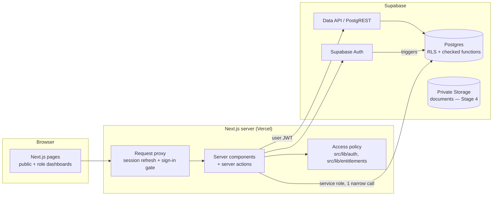
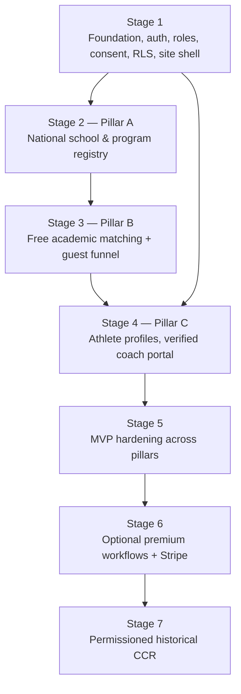

# Base Recruits — Architecture and Dependency Plan

Status: Stage 1 (foundation, web app, sign-in, role dashboards). See `docs/reports/stage-1.md` for the exit-gate evidence. Source of truth for product
requirements: `Base_Recruits_Claude_Master_Prompt.md` (v1.0). This document records how the product is being built and in
what order.

## 1. System shape

Three enforcement layers, each sufficient to stop a data leak on its own:

| Layer | What it enforces | Where |
| --- | --- | --- |
| Database | Row-level security on every table, column-level grants, writes only through checked `SECURITY DEFINER` functions, append-only audit, free-access triggers | `supabase/migrations/` |
| Server | Session gate on protected prefixes, role / onboarding / coach-verification gates in layouts, capability decisions | `src/lib/auth/`, `src/lib/entitlements/` |
| UI | Shows only what the server decided (effective consent state from `my_consent_grants()`); never the only protection | `src/app/` |

## 2. Modules and ownership boundaries

| Module | Responsibility | Stage | Code |
| --- | --- | --- | --- |
| Identity & roles | Accounts, profiles, roles, onboarding, neutral age screen | 1 | `…000200`, `…000500`, `src/lib/auth/roles.ts`, `src/lib/age/` |
| Coach verification | Affiliation evidence, admin review state machine, expiry, re-verification | 1 (Pillar C prep) | `…000300`, `src/lib/auth/coach-verification.ts` |
| Family & consent | Parent/guardian links, scoped revocable consent, minor rules, majority transition | 1 | `…000400`, `src/lib/consent/` |
| Audit | Append-only record of security-relevant changes | 1 | `…000100` |
| Entitlements | Capability catalog, free-core guarantees, premium gating (billing later) | 1 → 6 | `…000600`, `src/lib/entitlements/`, `src/config/plans.ts` |
| Institutions & programs | Registry of institutions and verified baseball programs, sources, imports | 2 (Pillar A) | — |
| Admissions source registry | Admissions statistics with cohort definitions and provenance | 2 | — |
| Academic matching | Explainable rule-based classifications, versioned | 3 (Pillar B) | — |
| Shortlists | Guest (on-device) and synced unlimited shortlists | 3 | — |
| Athlete recruiting profiles | Profile, metrics with evidence status, video | 4 | — |
| Coach portal | Search consented athletes, boards, messaging with guardrails | 4 (Pillar C) | — |
| Billing | Stripe, premium entitlements | 6 | — |
| Historical CCR | Permissioned outcomes, privacy thresholds, scattergrams | 7 | — |
| Assessment | Hitting and pitching assessments: evidence-labelled observations, anchored rubrics, coach targets, frozen reports, Film Room, training plans, development coach access. Switched off (decision F21) | After launch | `20261026000100`–`000600`, `src/lib/assessment/`, `src/app/(app)/assessment/`, `docs/assessment.md` |

Spec logical tables → Stage 1 implementation: `users` → `auth.users` + `profiles`; `coach_verifications` →
`coach_verification_events` + `coach_status_transitions`; `parent_athlete_relationships` → `family_links` +
`family_invites`; `consent_grants` → `consent_grants` + `consent_scope_rules`; `plans` / `subscription_entitlements` →
`capabilities` + `plan_capabilities` now, billing tables in Stage 6.

## 3. Stage dependencies and gates

Each stage stops at its exit gate with a report (`docs/reports/`). External dependencies that block a gate:

| Gate | Needs from outside engineering | Owner |
| --- | --- | --- |
| Stage 1 | npm registry access in the build environment; a Supabase project for Base Recruits (dev) | Founder / Jonathan Caceres |
| Stage 2 | College Scorecard API key (api.data.gov); review of NCAA / NAIA / NJCAA directory terms before automated import; a named data steward who approves imports | Founder / Jonathan Caceres + counsel |
| Stage 3 | Usability test participants (five-school shortlist in ~3 minutes target) | Founder / Jonathan Caceres |
| Stage 4 | Coach-verification reviewer(s) and turnaround standard; legal review of messaging with minors and recruiting-contact rules | Founder / Jonathan Caceres + counsel |
| Stage 6 | Stripe account; pricing decision; terms of sale | Founder / Jonathan Caceres |
| Stage 7 | Data-sharing agreements for applicant outcomes; privacy thresholds sign-off | Founder / Jonathan Caceres + counsel |
| Production | FERPA / COPPA / state student-privacy review; final privacy policy and terms | Counsel |

## 4. Security model (Stage 1)

- **Sign-up.** A neutral age screen comes first (an under-13 answer creates nothing and blocks retrying in that
  browser). The person then enters their role, name and email; Supabase emails a 6-digit code. Typing the code on the
  site proves they own the inbox; only then do they set the password, every other session is signed out, and the role,
  name and date of birth kept in that browser are applied as the account owner (`record_birthdate`,
  `complete_onboarding`). Nothing anyone attaches to an unconfirmed account is trusted, so registering someone else's
  email first gains nothing. Password reset uses the same code step. Confirmation links are not used.
- **Roles.** `athlete`, `parent`, `coach` are chosen once by the verified owner (`complete_onboarding`). The sign-up
  trigger reads a role only from app metadata, which only the service role can set (administrator-created accounts);
  user-supplied metadata is ignored. `admin` is granted only by an existing admin, or once by the database owner via
  `private.bootstrap_first_admin()`.
- **Writes.** Signed-in users have no `INSERT`/`DELETE` on any table and `UPDATE` only on named harmless columns (display
  name, email preferences, basic athlete fields). The service role has no direct table writes at all. Every other change
  goes through a `SECURITY DEFINER` function with a pinned `search_path`, explicit checks and an audit entry; functions
  that count before writing take a row or advisory lock. Tests assert the exact lists of callable functions.
- **App layer.** `src/proxy.ts` refreshes the session and sends anonymous visitors on protected prefixes to log in.
  Every protected page and layout calls `requireAccess()` (role, onboarding, coach verification) itself, and every
  server action ends at a database function or RLS check, so no gate depends on a layout alone. Session cookies are
  httpOnly (the browser never calls Supabase directly). Post-login redirects accept same-site paths only.
- **Private schema.** RLS helpers (`private.is_verified_coach`, `private.coach_can_view`, …) live in a schema the Data API
  does not expose.
- **Coach verification.** `private.is_verified_coach()` requires the coach role, admin-approved status `verified`, an
  unexpired window (default 365 days), and a confirmed account email equal to the email captured at approval. The email
  domain never grants access. Leaving `verified` for anything but a suspension clears the window; a suspension lifts only
  to the prior status. Expiry, email changes and role removal remove access immediately.
- **Consent.** Every coach- or family-facing visibility is a row in `consent_grants`: scoped, audience-bound, versioned
  to the consent wording shown, revocable, audited. Whether a grant is in effect is decided at read time from the
  current rules, the athlete's current age and the approving link — never from stored status alone, so the app shows
  the effective state. Audience-wide coach scopes only work while `coach_discovery` is on, so one switch hides
  everything. Document access names one person and expires within a year.
- **Minors.** Accounts require age 13+ (neutral age screen; an under-13 answer stores nothing but a block on retrying,
  and the blocked account cannot add any details). Ages are computed from the UTC date, so a request's time-zone
  setting cannot shift them.
  Unknown age is treated as a minor and never as an adult. Coach-facing grants by minors wait for approval by a linked
  **parent or legal guardian** — an adult account the athlete approved after seeing its name and email — and stay
  effective only while that link is active (table-driven; see `docs/decisions.md`). Links approved while the athlete was
  a minor stop working at 18 until the adult athlete re-approves; permissions given to that guardian end. Ages and
  relationships are self-attested; see residual risk in the Stage 1 report.
- **Date of birth.** Stored only in `profiles` (owner/admin readable), never in signup metadata or JWT claims; written by
  the server right after signup through one service-role function that only accepts brand-new accounts.
- **Audit.** `audit_events` stores identifiers and non-sensitive metadata. Functions log meaningful events; row-level
  triggers on profiles, roles, coaches, family links and consent independently record every insert, update and delete
  by any path (personal values such as emails and dates of birth are recorded only as "changed"). No role — not
  even the owner — can update, truncate or delete audit rows except the reviewed retention job, which must set an
  explicit switch.

## 5. Free-access invariants — how they are enforced

| Mechanism | Guarantee |
| --- | --- |
| `capabilities` table + triggers | A `core_free` capability cannot be re-tiered, re-scoped, renamed, deleted or attached to a paid plan, and a premium capability cannot be promoted to core while a plan still sells it (error `BR020`). New core capabilities must cite the product invariant they serve. |
| `private.has_capability()` | Core answers depend on role/verification only; the function never reads subscription data. |
| `decideCore()` in `src/lib/entitlements` | Core decisions receive only the viewer — no entitlement object — so billing code cannot influence them. Tests pass an entitlement source that throws if touched. |
| `RouteRequirement` type | Route rules can require sign-in, role, onboarding or coach verification; payment is not expressible. Public discovery routes have no rule. |
| `PlanDefinition.premiumCapabilities` | Typed as premium keys: adding a core capability to a plan is a compile error (verified). |
| Tests | 31 database assertions and 12 unit tests target these guarantees directly; a contract test keeps TypeScript and database catalogs identical. |

## 6. School registry and data provenance (Stage 2)

**Sources.** Only public U.S. Department of Education data is imported today: EADA (which institutions reported a men's
baseball team, its participants and the institution's athletics classification, per academic year) and College
Scorecard (institution facts, IPEDS admissions for a fall entering class, published prices for an academic year, fall
enrollment). Association directories, Common Data Sets and school pages are not scraped; a school's official pages
enter only through an administrator's reviewed correction that cites the page.

**Pipeline.** `data/pipeline` (Python, standard library + openpyxl) runs on GitHub's runners (`data-refresh` workflow,
`data/*` branches): it downloads the EADA release, keeps institutions with a men's baseball team, fetches their College
Scorecard records with the key held in a GitHub secret, labels every section with its year, and writes
`data/snapshots/registry-<season>.json` (one record per line, file and record checksums). Unknown codes and inconsistent
values are reported as issues and left blank. The snapshot is reviewed in a pull request and ships with the app.

**Import.** In the app an administrator stages a bundled snapshot (`/admin/data`). The server verifies the file's
format and record checksum, creates a job, sends the records in chunks, and the database validates every value and
computes the exact field-level changes against the live registry (new, changed, unchanged, missing, invalid). The
administrator can skip rows, then publishes; publishes and reviews take turns and a publish requires the registry
version its review was computed against. Restaging an earlier import is the rollback path.

**Records.** `institutions` (IPEDS unit id), `institution_aliases`, `baseball_programs` (one per institution: status,
season, association/division, reported classification, participants, conference and official links, verification level
and evidence), `admissions_statistics` (per fall term) and `institution_costs` (per academic year). Every source-backed
row stores its source, dataset, URL, year and retrieval time; triggers write every change to the append-only
`registry_revisions` log with the import job or administrator and the reason. An administrator's verified division or
confirmed status is never overwritten by an import for the same or an older season.

**Access.** Listed registry rows are readable by everyone, signed in or not (`search_schools`, `get_school`,
`compare_schools`, `registry_coverage` are SECURITY INVOKER, so row-level security applies); unlisted institutions and
everything about them are visible only to administrators. Reviewer ids, internal notes and import ids are excluded by
column grants. All writes go through admin-only SECURITY DEFINER functions.

**What is not imported yet.** GPA (not in federal data), majors, conferences (admin-verified only), net price (its
reference year could not be confirmed; each school's net price calculator is linked instead).

## 7. Environments

| Environment | Purpose | Status |
| --- | --- | --- |
| Local test database | Plain PostgreSQL + Supabase role/auth emulation; runs migrations and the security suite (`npm run test:db`) | Working |
| GitHub Actions CI | Every push and pull request: database suite, concurrency and contract tests on PostgreSQL 16 and 17; typecheck and unit tests under Vitest | Working |
| Local Supabase (`supabase start`, Docker) | Full Auth + Data API for development and end-to-end tests; codes land in the local mail catcher | Working in CI; requires Docker on a developer machine |
| Supabase dev project | Shared development and end-to-end tests | Not created — founder decision |
| Production | Supabase project `Base Recruits` (us-east-2) + Vercel; migrations deploy from `main` (`docs/deployment.md`) | Being set up 2026-10-23 |
| Staging | Separate Vercel + Supabase project and secrets | Stage 5 |

## 8. Scheduled jobs

`private.run_scheduled_maintenance()` (daily via `pg_cron` on Supabase) expires coach verifications and consent grants and
flags guardian links that need re-consent at 18. Access does not depend on the job: every helper checks expiry and age
at read time.

## 9. Assessment module (switched off)

Built on the same three layers. Database: every Assessment table has row-level security keyed on
`private.assessment_relation` (athlete, guardian with `family_assessments` consent, or development coach with
`development_coach_access` consent and an open link); writes go only through checked functions that lock what they
check; published reports are frozen by trigger; private Storage policies call `private.assessment_object_access`.
Server: the `/assessment` routes are behind the sign-in gate (signed-out visitors go to the public explainer) and the
site switch (`NEXT_PUBLIC_ASSESSMENT_ENABLED`); the database switch (`private.assessment_settings`) refuses every
write while off. Scores are calculated in SQL (`private.assessment_results`, `calc-v1`) and mirrored in TypeScript,
with a contract test proving they agree. Details: `docs/assessment.md`.

