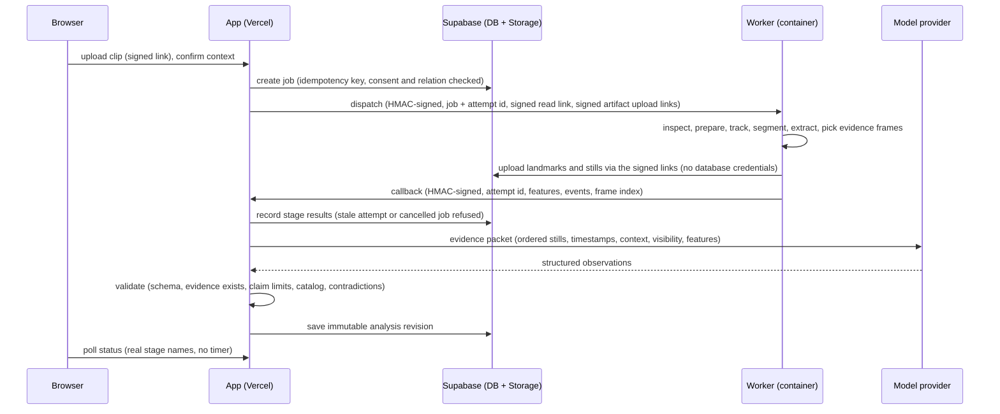

# SeamState — Base Recruits Assessment engine (design, Milestone 1)

Status: **design approved 2026-10-27 (F30–F35); build in progress on a branch.** Nothing in this document is built yet unless a section says so. SeamState lives inside
Assessment (`docs/assessment.md`), uses the same accounts, athletes, relations, switches and private storage, and stays
off until the founder opens Assessment (decision F21). Founder decisions this design needs are listed in §11 and in
`docs/decisions.md` (F30–F35).

Promise inside Assessment: **"Record your swing. Understand what is working. Know what to practice next."**

## 1. Current implementation map (verified 2026-10-27, `main` at `71d26bb`)

| Area | What exists | Where |
| --- | --- | --- |
| Framework | Next.js 16.4 (App Router, server components and server actions), React 19.3, TypeScript 6 strict, Tailwind 4, zod 4, npm, Node 22.12+ | `package.json` |
| Hosting | Vercel (Pro), production branch `main`, `https://baserecruits.app` | `docs/deployment.md` |
| Database, Auth | Supabase (Pro, us-east-2). Postgres with RLS everywhere; writes only through checked `SECURITY DEFINER` functions; migrations deploy on merge to `main` | `supabase/migrations/`, `CONTRIBUTING.md` |
| Accounts and relations | Athlete, parent, coach, admin, development coach; guardian approval for minors; scoped, revocable consent grants; verified college coaches (365 days) | `…000200`–`…000500`, `src/lib/auth/`, `src/lib/consent/` |
| Assessment | Built, **switched off** (site variable `NEXT_PUBLIC_ASSESSMENT_ENABLED` and a database switch). Hitting and pitching protocols, 30 metrics (14 anchored rubrics), the four hitting pillars SeamState uses (Load & Timing, Barrel Delivery, Lower-Body Contribution, Impact & Output), evidence categories, frozen report revisions, Film Room, rules-based training plans, progress, development coach connections, sharing published reports with a verified college coach | `docs/assessment.md`, `src/lib/assessment/`, `src/app/(app)/assessment/` |
| Capture context already modelled | Drill type (`tee`, `front_toss`, `overhand_bp`, `machine`, `live_bp`, `game`), batting side, camera view (`side_facing`, `side_behind`, `front_on`, `rear`, `overhead`), timing basis (real time, slow motion with factor, unknown), age band (never the date of birth) | `src/lib/assessment/catalog/context.ts`, `public.assessments`, `public.assessment_media` |
| Video | Private bucket `assessment-media`, signed one-time upload, ≤ 200 MB, mp4/mov/webm, signed 15-minute playback links, deletion checked by the database. Video switch **off** pending legal review (F23, L9). **Nothing is transcoded, analysed or sent to an outside service** (F23 as decided) | `src/app/(app)/assessment/media-actions.ts`, `src/lib/assessment/server/storage.ts` |
| Film Room | Frame stepping, playback speed, event markers (`load_start`, `foot_contact`, `swing_start`, `contact`, `finish`), notes, drawings, side-by-side comparison aligned on a marker | `src/app/(app)/assessment/film/` |
| 9-Zone Hitting | Built from the founder's workbook (SHA-256 recorded): 9 zones, 39 drills, 9 stages, 5 pairings, 49 constraints; session builder, live tracker with predeclared assignments, review, development path | `docs/assessment.md` §10, `src/lib/assessment/zones/`, `data/zone-hitting/` |
| Drills | 18 written Assessment drills + 39 workbook drills, **not yet reviewed by a qualified coach** (F26, F27) | `src/lib/assessment/catalog/drills.ts`, `src/lib/assessment/zones/content-v1.json` |
| Background jobs | None for media. Supabase `pg_cron` is used for daily maintenance only | README |
| Workers, media processing, pose models | **None** | — |
| Model providers | **None.** No API key, SDK or environment variable for any language or vision model | `.env.example` |
| Existing SeamState code | **None in this repository.** No other SeamState repository is connected to this project | — |
| Tests | Vitest unit and contract tests, plain-SQL database security suite (PostgreSQL 16/17 and a real Supabase stack), concurrency scenarios, Playwright end to end with axe, all in CI | `.github/workflows/ci.yml` |

SeamState reports only what a phone clip can show. Measurements that need lab equipment (force plates, 3D motion
capture, ball tracking) are listed under "What this video cannot tell us", never estimated.

## 2. Reuse versus new build

| Need | Decision | Why |
| --- | --- | --- |
| Accounts, athletes, guardians, development coaches, college coach sharing | **Reuse** unchanged | One identity, one consent model. College coaches keep seeing only published reports an athlete shared, never clips or SeamState working data |
| Capture session | **Reuse** `assessments` (protocol `hitting-video`) as the session; **new** `seamstate_captures` row per clip for setting-specific context | Context fields already exist and are tested; setting-specific fields (tee location, toss announced, coach BP vs live, machine setting as entered) are new |
| Clip storage and upload | **Reuse** `assessment_media`, bucket, signed uploads and deletion; **add** content hash and decoded-media inspection | Already private, rate-limited and deletion-safe |
| Pillars and rubric conversion | **Reuse** the four hitting pillars, `25 × (rating − 1)`, missing ≠ zero, pillar coverage rule | Identical to what the brief asks for; one scoring system |
| Event types | **Reuse** Film Room's event names; AI-detected events are stored separately and can be accepted as markers | Film Room already seeks, aligns and compares on these |
| Film Room, "Show me" | **Extend** with deep links to a time, evidence thumbnails and an overlay drawn from stored landmarks | No second player |
| Training plans, logs, reassessment | **Reuse**; add rules that map a SeamState finding to drill IDs | Plans are already rule-based and auditable |
| 9-Zone Hitting | **Reuse**; findings can suggest a focused round; zone advice only when location is known (manual label) | Already task-aware |
| Media inspection, pose tracking, segmentation, features, evidence frames | **New:** small worker service (§4) | Cannot run inside a Vercel request or Supabase Edge Function reliably |
| Interpretation (multimodal model) | **New:** server-side call from the app, after the worker (§5) | Keeps prompts, catalog, validation and the API key in one TypeScript codebase with the existing domain rules |
| Analysis schema, mechanic catalog, eligibility, evidence grades, output validator, drill mapping | **New** framework-free modules in `src/lib/seamstate/` with unit tests | Same pattern as `src/lib/assessment/` |
| Analyses, findings, reviews | **New** tables (§3) | Immutable revisions with provenance |

## 3. Data model and job architecture

New migration(s), following every rule in `CONTRIBUTING.md` (RLS on, privileges revoked, writes only through checked
functions, audits that record a change and never the value, race tests for check-then-write).

As built in `supabase/migrations/20261028000300_seamstate_enum_values.sql` and `…000400_seamstate.sql` (tests in
`supabase/tests/database/020_seamstate.test.sql`):

| Table | Holds |
| --- | --- |
| `seamstate_captures` | One clip's context: assessment, media, athlete, setting (`tee`/`front_toss`/`overhand_bp`/`machine`), the setting's own answers (checked by `private.seamstate_context_problem`, which mirrors `src/lib/seamstate/capture.ts`), batting side (confirmed by the person, never guessed from pixels), camera view, task, devices, filming notes, capture protocol version |
| `seamstate_media_inspections` | Decoded facts about a clip: SHA-256, container, codec, width, height, rotation, measured frame rate, variable-frame-rate flag, frame count, duration, inspector version |
| `seamstate_jobs` | One analysis request: capture, state (`queued`, `preprocessing`, `analyzing`, `needs_input`, `complete`, `partial`, `failed`, `cancelled`), idempotency key (unique per requester), pipeline version, current attempt, attempt count, failure kind (`service` vs `footage`) and code |
| `seamstate_job_attempts` | Attempt number, worker version, stage reached, per-stage timings and counts (no media, prompt text or model output), error code, last report time |
| `seamstate_analyses` | Immutable revision: job, revision, parent revision, cause (`initial`, `correction`, `reanalysis`), clip verdict, pipeline/model/catalog/policy/schema versions, the **evidence packet** (swings, events, evidence stills and visibility, as defined in `src/lib/seamstate/packet.ts`) and the **result** (eligibility, unable-to-assess items, rejection counts) |
| `seamstate_findings` | Validated findings: mechanic, pillar, category, priority, swings, observation, interpretation, experiment, reassessment, cue, cited stills, limitations, alternative explanations, eligible and observed swing counts, evidence grade and reasons, drill suggestions, review state. Only the review state can change |
| `seamstate_reviews` | Append-only review history (approve, reject, note) |

Changes from the Milestone 1 proposal, made while building:

- **Swings, events and evidence stills are stored in the analysis's `packet`**, not in separate tables. They are only
  ever read together with their analysis, they must be frozen with it, and the database still checks that every still a
  finding cites is in that packet. Subject tracks and per-frame features stay in the worker's artifacts until the
  correction and subject-selection steps need them in the database.
- **Six worker callback functions are callable by the service role** (`seamstate_worker_begin_attempt`, `_report`,
  `_record_inspection`, `_artifact_path`, `_save_analysis`, `_due_jobs`). This is a deliberate widening of the security model: before
  SeamState, the service role could call exactly one function. The worker itself still has no database credentials; the
  app server calls these only after verifying the worker's signature, and every one refuses an attempt that is no longer
  the job's current one, a job that was cancelled or finished, a job whose athlete withdrew permission (it is cancelled,
  so no stills go to the provider), and any job while SeamState is switched off (it fails as a service problem).
  `007_privileges_and_exposure.test.sql` pins the exact list.
- **Spending limits** live in `private.seamstate_settings` (off, per-person daily limit 5, site-wide monthly limit 0 until
  an administrator raises it) and are counted in private usage records that removing a clip never gives back.

Large data (stills, the packet file, landmarks) lives in the private bucket `seamstate-artifacts`, path
`athlete/media/job/attempt/file`, readable only by people who can work on the athlete's assessments. Only the server
writes there. Removing a clip deletes its SeamState records in the database (a trigger on `assessment_media`); the app
deletes the clip's artifacts under `athlete/media/`.

Consent: scope `seamstate_analysis` with the new audience `outside_service` (no person receives access), reusing the
existing grant and guardian-approval flow: active immediately for adults, waits for a parent or legal guardian for
under-18s, at most 365 days, revocable. It is separate from any permission to reuse footage for model training, which
SeamState does not request. Wording is pending counsel (L12).

### Job flow

The worker holds no database or provider credentials: it receives signed links for exactly one clip and its artifact
paths, and answers with a signed callback. A Vercel cron sweeper re-dispatches attempts that stopped reporting (at most
three attempts, with backoff) and marks the job `failed` with failure kind `service`, never as a footage problem.

## 4. Worker and inference pipeline

Python 3.12 container: `ffprobe`/`ffmpeg` for inspection and frame decoding, MediaPipe Pose Landmarker (Tasks API,
`mediapipe` on PyPI, Apache-2.0; model bundle licence and version to be pinned and recorded at build) on CPU, numpy.
No GPU.

| Stage | Worker does | Never |
| --- | --- | --- |
| Inspect | Read real metadata and presentation timestamps; measure actual frame rate and variable frame rate; rotation; check the file signature matches its type | Trust the filename or container claims over decoded data |
| Prepare | Decode analysis frames at source timing (no interpolation); keep a source-to-derivative time map; make a playback-friendly copy only if the browser cannot play the original | Use generated frames as evidence |
| Select athlete | Detect up to 4 people; track by position and size; propose the batter; ask the user to tap the athlete when more than one candidate is plausible (`needs_input`) | Silently switch to the pitcher or a coach |
| Segment | Find candidate swings from hand and hip motion in the image plane; mark waggles and pauses; user can correct boundaries. Only swings where the bat hits the ball count (decision F37); the AI review decides contact, see §5 | Invent a swing when none is found (`No swing detected`) |
| Track | Landmarks with per-point visibility; tracking gaps kept as gaps | Fill an occluded event and report it as certain |
| Extract | Only permitted image-plane and temporal features (§6), normalised by body size in the frame, documented smoothing | Bat speed, exit velocity, forces, torque, true 3D rotation |
| Evidence frames | Pick stills around each event (before, at, after) with exact frame index and time; crop to the athlete | Send the whole video or unrelated people |

Quality gates (per clip and per finding): athlete size in frame, feet/hands/torso visibility, blur, lighting, camera
motion, measured frame rate, movement coverage (setup through finish), number of people, swing detected, contact
locatable. Results: suitable, limited (lists what can and cannot be assessed), retake recommended (one specific reason,
e.g. "Keep both feet visible through the finish"), no swing detected, subject selection required. Capture quality,
tracking reliability, evidence strength and athlete performance are reported separately.

## 5. Interpretation, validation and cost

Provider: **Anthropic Claude API** (vision input, structured JSON output), called from the app server with a key held
only in Vercel's server environment. The Claude Max subscription used for development does not pay for the site's
analysis calls; the site needs its own API account, key and spend limit.

The model receives: capture setting and drill, view and batting side, which events are known, estimated or missing,
which landmarks are usable, the computed features, ordered stills with timestamps, what it is allowed to claim, what
counts as an unsupported inference, and that "no issue found" is a valid answer. It returns observations against the
mechanic catalog only. It does not produce numbers, benchmarks, confidence percentages or scores; scores and evidence
grades are computed by versioned code. Filenames, captions, scene text and the model's own output are treated as
untrusted data.

A swing counts only when the bat visibly hits the ball in frame (decision F37). Before any finding, the model returns
`swingContact` for every swing it was shown: `bat_hits_ball`, `no_contact` (a practice swing or a miss) or `unclear`,
citing frames of that swing (for example the ball on the tee before the swing and gone after). Only `bat_hits_ball`
backed by that swing's own frames counts. Any other swing, including one the model did not report, is treated as not
assessable: findings on it are rejected (`swing_without_contact`), and eligibility, swing counts and evidence grades
use the counted swings only. The contact calls are saved with the analysis result.

The validator rejects or downgrades (§17 of the brief): out-of-range or nonexistent frames and times; unknown metrics or
units; repeated patterns from one swing; pitch recognition on tee work; claims about untracked or occluded anatomy;
contradictory findings for the same event; any bat or ball speed; 2D-as-3D statements; drill IDs not in the catalog;
medical or recruiting predictions; numbers not reproducible from the rules. One bounded retry, then a partial result.

Model choice and cost (list prices verified in Anthropic's current model table, 2026-10-27; to be re-measured with real
token counts in Milestone 2):

| Model | Price per million tokens (input / output) | Estimated cost per analysed clip* |
| --- | --- | --- |
| Claude Opus 5.5 (`claude-opus-5-5`) | $4 / $20 | about $0.25–$0.45 |
| Claude Sonnet 5.5 (`claude-sonnet-5-5`) | $2 / $10 | about $0.13–$0.23 |

\* Assumes about 24 cropped stills (~1,300 tokens each), ~6,000 tokens of context and features, and 4,000–8,000 output
tokens including reasoning. Recommendation: start the pilot on Opus 5.5 and let the evaluation harness (§9) decide
whether Sonnet 5.5 matches it on reviewed clips.

Worker compute on a pay-per-use container host is roughly a cent or less per clip (about a minute of 2 CPUs) and costs
nothing while idle. Spend controls: per-person daily analysis limit, a site-wide monthly cap counted in the database
(analysis pauses with an honest message when reached), and a hard monthly limit set in the provider's console.

Missing credentials: the job ends in `failed` with failure kind `service` and the page says "Swing analysis is not
available yet" with the exact configuration missing (for administrators). No synthetic output is ever produced.

## 6. Mechanic catalog v1 (proposed; every entry needs coach review before opening)

Start small and reliable. Bat-barrel path is **unavailable** in v1: the pose model tracks the body, not the bat.

| Key | Pillar | View | Needs | Min. swings | Method | Must stay unclaimed |
| --- | --- | --- | --- | --- | --- | --- |
| `setup_base` | Lower-Body | side_facing, front_on | both feet visible at setup | 1 (3 for repeatability) | Stance width ÷ hip width, image plane | Weight distribution |
| `load_pattern` | Load & Timing | side_facing | hands and back hip visible | 1 | Onset and direction of hand/hip movement before forward swing | Timing "against the pitch" on tee |
| `head_movement` | Load & Timing | side_facing (in-plane), front_on (lateral) | head and torso tracked through contact interval | 1 | Head displacement ÷ torso length, stated phase | Eye tracking, pitch recognition |
| `stride` | Lower-Body | side_facing (length), front_on/rear (direction) | lead foot visible | 1 | Presence, length ÷ stance, visible-plane direction | A no-stride swing is valid, not a flaw |
| `foot_contact_to_swing` | Load & Timing | side_facing | lead-foot contact and forward-swing onset events | 1 (3 for timing variation) | Frames between events; milliseconds only with measured real-time ≥ 60 fps | Millisecond values from slow-motion of unknown factor |
| `posture_change` | Lower-Body | side_facing | torso tracked setup → contact | 1 | Torso angle change in the camera plane; pitch height noted when known | Low-pitch posture is not automatically an error |
| `lead_knee` | Lower-Body | side_facing | lead hip, knee, ankle visible | 1 | Knee angle change in the image plane | Force or "energy transfer" |
| `hands_to_torso` | Barrel Delivery | side_facing | wrists and shoulders tracked | 1 | Hand path relative to torso in the image plane | Barrel path, bat speed, attack angle |
| `contact_interval` | Impact & Output | side_facing | visible contact region | 1 | Interval or unknown; visual estimate | Exact contact frame when unresolvable; exit velocity |
| `finish_support` | Lower-Body | any full-body view | feet and torso visible through finish | 1 | Base maintained, steps out, balance in the visible sequence | One-handed finish is not a flaw |
| `repeatability` | Across pillars | same view | ≥ 3 assessable comparable swings | 3 | "Observed in n of m assessable swings", calculated | Any pattern from one swing |

Each entry in code also records supported settings, known failure conditions, allowed source methods and evaluation
status (`not_evaluated` until §9 has results).

Capture settings change interpretation: tee (no pitch recognition, chase or timing against a ball), front toss (timing
only if release/flight/contact are visible; location announced or not), overhand (coach BP vs live, known vs mixed
pitches; no velocity inferred), machine (setting stored as entered, never as measured; not equivalent to live pitching).
Settings are never pooled into one longitudinal score.

## 7. First end-to-end deliverable (Milestone 2)

One authorized, uploaded side-view tee clip goes through real inspection, real pose tracking, swing segmentation,
features, evidence stills, a real Claude call, validation and a saved analysis, and shows a report: what looks
effective, what to work on next, your next practice (one cue), each finding with "Show me" that opens Film Room at the
supporting moment, and "What this video cannot tell us". Built behind the existing Assessment switches, on a branch,
run against the local Supabase stack and a development worker. Recording in the browser (Milestone 3) and the other
three settings (Milestone 4) follow.

### Screens as built

- **Clips step** (`src/app/(app)/assessment/[id]/clips-step.tsx`, hitting assessments only). When SeamState is on, a
  "SeamState swing analysis" panel explains the permission and lets the athlete allow it (`grant_consent`,
  `seamstate_analysis`) or turn it off (`revoke_consent`, which cancels anything under way). A parent or coach sees
  what the athlete still has to do. Each uploaded clip gets a swing-details form (setting first; only that setting's
  questions are shown) and then its job status with the real stage name, refreshed every 5 seconds while it runs,
  with a cancel button. The privacy sentence under the clips (and on the public Player Assessment page) says what
  SeamState sends, in the founder's approved wording (F36).
- **The lock** (F36). `seamstate_enabled()` and `admin_set_seamstate_settings` require
  `private.seamstate_settings.outside_analysis_disclosed`, which no function sets. It was false while the site promised
  video was never sent to an outside analysis service; migration `20261028000500_seamstate_disclosure` set it with the
  approved replacement wording. A unit test (`tests/unit/seamstate-screens.test.ts`) fails if any migration sets it while
  either page still makes the old promise, and checks the approved wording on both pages.
- **Swing report** (`/assessment/[id]/swing/[jobId]`): the video-check result with retake advice and which swings
  were not counted (F37), then "What looks
  effective", "Possible adjustments" (with "Also noted"), "Your next practice" (experiment, cue, catalog drills
  labelled as not yet coach-reviewed, how to check it again) and "What this video cannot tell us". Every finding shows
  its evidence stills (signed one-hour links, read under the person's own permission), the evidence grade with its
  reasons and alternatives, "Show me in the Film Room" at the cited moment, and its review history. A development coach
  approves or rejects; anyone with access can add a note. Findings are labelled provisional until approved.
- **Admin** (`/admin`): the SeamState switch, per-person daily limit, monthly limit with this month's usage, which
  deployment settings are still missing, and a separate switch for athletes under 18 that starts off (L12). With it
  off, minors' clips are refused even with a guardian's approval, and a job already queued for a minor stops.
- **Removal**: removing a clip, or deleting a draft assessment, also deletes the clip's stills and packet from
  `seamstate-artifacts`.
- **Not built yet**: choosing the hitter when several people are in the video (the job asks the person to cancel and
  film again), recording in the browser (Milestone 3), and comparing reports over time.

## 8. Acceptance tests (mapped to the brief's scenarios)

| # | Scenario | Test |
| --- | --- | --- |
| A | Tee clip gets footage-specific feedback, no pitch-decision metrics | Real model run on an authorized tee clip; validator unit tests reject recognition/chase/timing-vs-pitch on tee |
| B | Front toss reports only what visible events support | Unit: eligibility by setting and visible events; real run on a front-toss clip |
| C | Overhand and machine keep their differences | Unit: setting-specific eligibility; machine setting stored as `athlete_reported`; comparisons refuse mixed settings |
| D | Poor clip gets specific retake guidance | Worker fixtures: cropped feet, dark, shaky → named retake reason, no mechanics findings |
| E | No swing → no swing findings | Worker fixture (person standing) and validator test |
| F | One swing is never "a pattern" | Validator unit test |
| G | "Show me" opens the supporting moment | Playwright: click a finding, Film Room seeks to the stored time |
| H | Correction creates an auditable revision | Database test: correction → new revision, original unchanged, audit row |
| I | Approved finding maps to a catalog drill | Unit: mapping rules; validator rejects unknown drill IDs |
| J | Follow-up compares compatible observations and names changed conditions | Unit: comparability rules (setting, view, fps class, catalog version) |
| K | Other athletes and unauthorized recruiters get nothing | Database tests for every table and artifact path; Playwright cross-athlete 404 |
| L | Missing model credentials → honest blocked state | Integration test with no key: job `failed`/`service`, no findings |

Engineering tests also cover malformed uploads, unsupported codecs, duplicate submissions (idempotency), worker crash
and bounded retry, provider timeout and malformed output, stale and late callbacks after cancel/delete, missing
landmarks, missing vs zero scores, historical model compatibility and regressions in existing features. Recorded
provider responses are used only as labelled test fixtures; real model-backed runs are also required. Desktop viewport
emulation is not mobile validation: iOS Safari and Android Chrome checks on real phones are listed as pending until done.

## 9. Evaluation (accuracy is not established by software tests)

An evaluation harness runs the pipeline on authorized, coach-annotated clips (both batting sides, all four settings,
different views and phones, no-stride hitters, poor light, occlusion, no swing, multiple people, missing contact,
variable frame rate and slow motion, single and multiple swings), split by athlete. Measures per feature: event-timing
error, tracking coverage, unsupported-finding rate, precision and recall per defined finding, agreement with reviewed
labels, appropriate abstention, repeatability across runs, evidence-link correctness, latency and cost. Release
thresholds are written down before the first run. Until then SeamState is labelled an operational prototype, not a
validated product.

## 10. Copy and identity

"SeamState" appears prominently inside Assessment with the descriptor "Base Recruits Assessment". Preferred phrases:
"What looks effective", "Possible adjustments", "See the evidence", "Your next practice", "Compare your progress". No
diagnoses, one-ideal-swing statements, guaranteed gains, invented credentials, outcomes, testimonials, accuracy figures,
partnerships or athlete counts. The brief also bans the pricing adjective spelled F-R-E-E in customer copy; the merged
site copy (pull request #18) uses it for built discovery features, so that conflict is a founder decision (F35), and
SeamState pages simply do not use the word.

## 11. Genuine missing dependencies

| # | Needed | From | Blocks |
| --- | --- | --- | --- |
| 1 | Counsel's review of the approved privacy wording (F36, done 2026-10-28) with the consent text, and of minors' footage going to the provider (L9, L12) | Counsel | Any real analysis of a real athlete |
| 2 | Anthropic API account, key in Vercel, monthly spend limit | Founder | Milestone 2's real model run |
| 3 | Worker host account (recommended: Google Cloud Run; alternatives Railway or Fly.io) | Founder | Milestone 2 in a deployed environment (local development works without it) |
| 4 | Authorized swing clips: 3–5 to start (side view, tee), later about 40+ across settings for evaluation, with written permission | Founder | Milestone 2 real run; §9 |
| 5 | A qualified hitting coach to annotate evaluation clips and review the mechanic catalog and drills (F26, F27) | Founder | Opening; validated labels |
| 6 | Real phones (iPhone Safari, Android Chrome) for capture testing | Founder | Milestone 3 sign-off |
| 7 | Supabase Storage upload limit ≥ 200 MB | Founder | Large clips |
